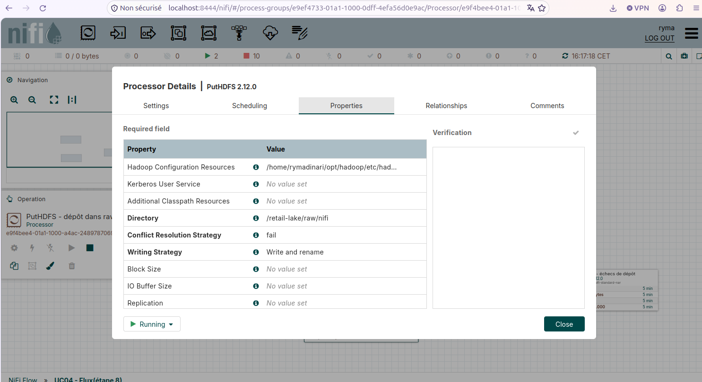
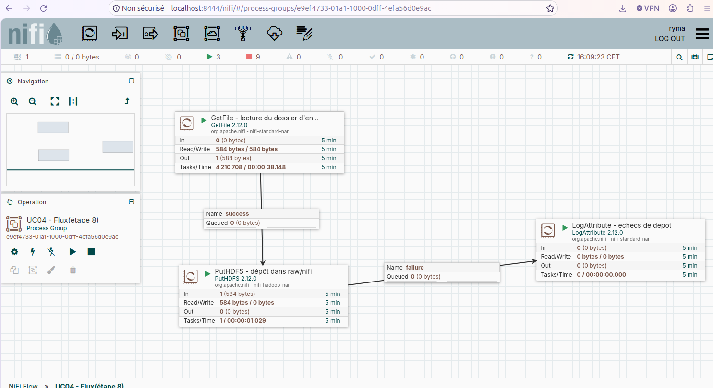
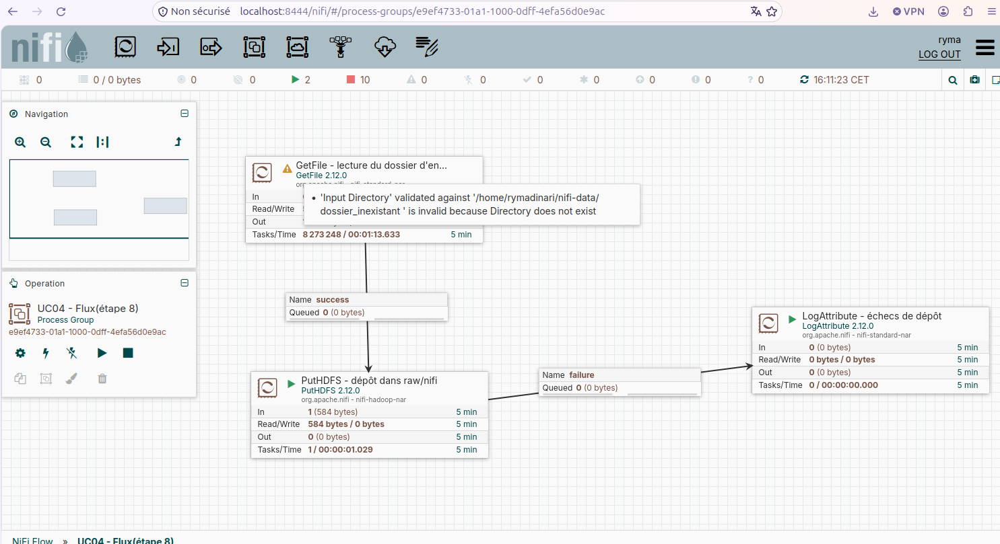
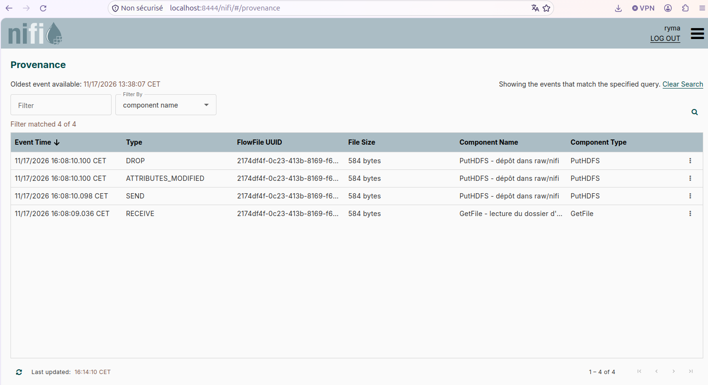
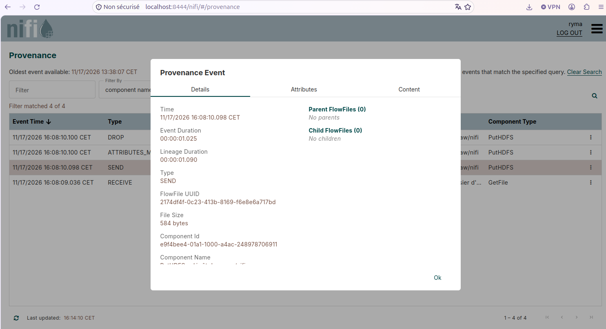
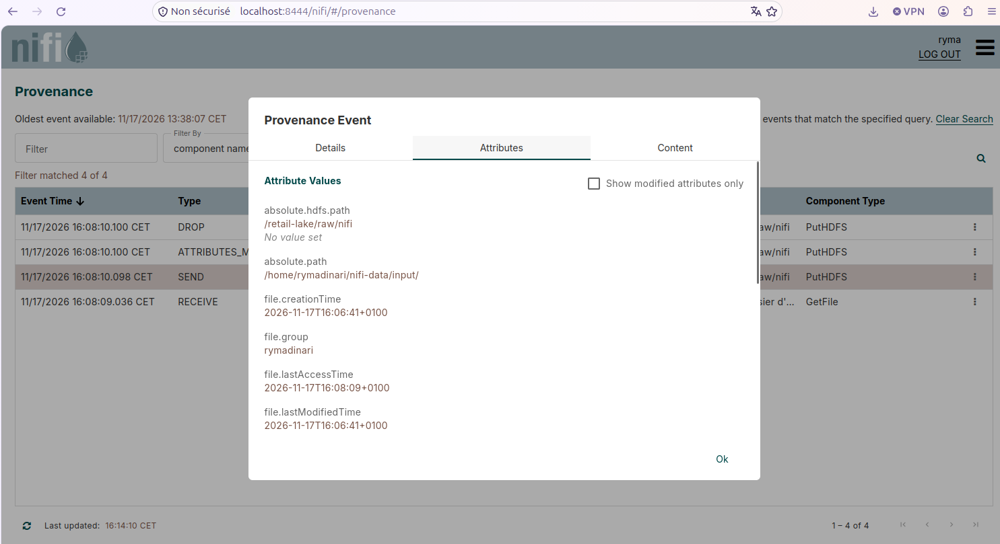

# Flux d'ingestion NiFi (UC-04)

Tout ce qui est décrit ici a été **réellement fait** le 17/11/2026 sur NiFi 2.12.0 et HDFS 3.5.0, dans l'interface de NiFi. Aucune solution de repli n'a été nécessaire. Les preuves sont dans `preuves/j2/nifi/` et les captures dans `preuves/j2/nifi/captures/`.

## 1. Découverte de NiFi (étape 6)

| Élément | Valeur relevée |
|---|---|
| Version | NiFi 2.12.0 |
| Adresse de l'interface | `https://localhost:8444/nifi` (le port 8443 est déjà pris sur mon poste) |
| État général au départ | Démarré (`nifi.sh status` → UP), aucun processeur, rien en attente |
| Instance | Une seule instance, pas de cluster |
| Composants disponibles | 304 processeurs et 125 Controller Services. GetFile, PutHDFS et LogAttribute sont présents. |
| Services nécessaires à l'ingestion | HDFS démarré et joignable sur `hdfs://localhost:9000` ; fichiers `core-site.xml` et `hdfs-site.xml` lisibles par NiFi. |
| Contraintes de sécurité | HTTPS avec un certificat auto-signé (le navigateur affiche un avertissement), un seul utilisateur avec mot de passe, accès limité à `localhost`. |

Preuves : `01_demarrage_nifi.txt`, `02_decouverte_nifi.txt`.

Problème rencontré : dans NiFi 2.12.0, **PutHDFS n'est pas inclus** dans le téléchargement standard. J'ai ajouté les deux modules officiels Apache (`nifi-hadoop-nar` et `nifi-hadoop-libraries-nar`, version 2.12.0, téléchargés sur Maven Central, empreintes vérifiées) dans `~/opt/nifi/extensions/`. Après ça, PutHDFS apparaît dans la liste.

### Les notions de NiFi

| Notion | Ce que c'est | Dans mon flux |
|---|---|---|
| **FlowFile** | Un « colis » qui circule dans le flux : le contenu d'un fichier + une étiquette avec des attributs (nom, chemin, taille, date…). | Le fichier `warehouse.dat` lu dans `~/nifi-data/input` est devenu un FlowFile. |
| **Processor** | Une étape qui fait une action : lire, écrire, modifier, trier… | GetFile (lire), PutHDFS (écrire dans HDFS), LogAttribute (écrire dans le journal). |
| **Connection** | Le tuyau entre deux processeurs. Elle transporte les FlowFiles pour une relation donnée (`success`, `failure`…). | GetFile → PutHDFS sur `success` ; PutHDFS → LogAttribute sur `failure`. |
| **Queue** | La file d'attente visible sur une connexion : les FlowFiles qui attendent d'être traités. | Affichée sur chaque flèche (« Queued 0 » quand tout est passé). |
| **Process Group** | Une boîte qui regroupe plusieurs processeurs pour ranger le canvas. | « UC04 - Flux(étape 8) ». |
| **Controller Service** | Un service partagé par plusieurs processeurs (connexion à une base, lecteur CSV…). | Pas utilisé : PutHDFS lit directement les fichiers de configuration Hadoop. |
| **Provenance Repository** | L'historique de chaque FlowFile : reçu, modifié, envoyé, terminé, avec l'heure. | Voir le §7 et `docs/ingestion/provenance.md`. |

## 2. Pourquoi NiFi après le dépôt manuel

Avec `hdfs dfs -put` (UC-03), il faut taper une commande pour chaque fichier. Avec NiFi, on dépose un fichier dans un dossier et il part tout seul vers HDFS, avec un historique et une gestion des erreurs. Si un nouveau lot arrive chaque jour, personne n'a besoin d'intervenir.

Pour ne pas écraser le dépôt manuel, le flux écrit dans un dossier à part : `/retail-lake/raw/nifi`. Le fichier de test est une **copie** de `warehouse.dat` du kit ; l'original reste dans `~/TP1/retail_project/data/warehouse/`.

## 3. Construction du flux (étapes 7 et 8)

J'ai construit le flux à la main dans l'interface, dans un Process Group « UC04 - Flux(étape 8) » :
1. ajout de GetFile, PutHDFS et LogAttribute avec le bouton *Add Processor* ;
2. réglage de chaque processeur avec clic droit → *Configure* (onglets *Settings*, *Properties*, *Relationships*) ;
3. création des deux flèches en les tirant à la souris d'un processeur à l'autre.

Juste après leur ajout, les processeurs avaient un ⚠️ : leurs relations n'étaient pas encore reliées. Une fois les flèches créées, les trois sont devenus valides.

### Schéma

```
 ~/nifi-data/input/                         HDFS
 (copie de warehouse.dat)
        │
        ▼
 ┌──────────────┐   success   ┌────────────────────────┐   success → terminé (fichier déposé)
 │   GetFile    │ ──────────▶ │        PutHDFS         │
 │ lit le       │             │ écrit dans             │
 │ dossier      │             │ /retail-lake/raw/nifi  │
 └──────────────┘             └───────────┬────────────┘
                                          │ failure
                                          ▼
                              ┌────────────────────────┐
                              │      LogAttribute      │  success → terminé
                              │ écrit les attributs du │
                              │ fichier en échec dans  │
                              │ le journal nifi-app.log│
                              └────────────────────────┘
```

## 4. Réglages des processeurs



| Processeur | Propriété | Valeur | Pourquoi |
|---|---|---|---|
| GetFile | Input Directory | `/home/rymadinari/nifi-data/input` | Dossier d'entrée réservé au test. |
| | Keep Source File | `false` | Le fichier est retiré du dossier après lecture, pour ne pas être lu deux fois. C'est pour ça qu'on y met une **copie**. |
| | Recurse Subdirectories | `false` | On ne lit que le dossier lui-même. |
| PutHDFS | Hadoop Configuration Resources | `core-site.xml` et `hdfs-site.xml` de `~/opt/hadoop/etc/hadoop` | C'est grâce à eux que NiFi sait où trouver HDFS. |
| | Directory | `/retail-lake/raw/nifi` | Un dossier différent de celui du dépôt manuel (UC-03), pour ne pas l'écraser. |
| | Conflict Resolution Strategy | `fail` | Si un fichier du même nom existe déjà, NiFi refuse de l'écraser : le FlowFile part en `failure`. |
| | Relation `success` | terminée automatiquement | Le fichier est déposé, il n'y a plus rien à faire. |
| | Relation `failure` | reliée à LogAttribute | Je garde une trace des échecs au lieu de les jeter sans les voir. |
| LogAttribute | Log Level | `warn` | Pour que les échecs ressortent dans le journal. |
| | Relation `success` | terminée automatiquement | Une fois l'échec noté, le FlowFile est terminé. |

## 5. Test du flux (étape 9)

J'ai fait le test deux fois, toujours avec ce même flux.

**Premier test, à 16:08, avec `warehouse.dat` (584 octets)**
1. J'ai copié `warehouse.dat` dans `~/nifi-data/input`. J'ai choisi un petit fichier, comme le demande l'énoncé.
2. J'ai démarré PutHDFS, puis LogAttribute, puis GetFile en dernier.
3. GetFile a lu le fichier à 16:08:09 et PutHDFS l'a écrit dans `/retail-lake/raw/nifi` une seconde plus tard. Son empreinte SHA-256 dans HDFS était identique à l'original.
4. J'ai ensuite arrêté GetFile.



*Capture prise à 16:09, juste après le passage de `warehouse.dat`. GetFile : Out = 1 (584 bytes). PutHDFS : In = 1 (584 bytes). La file `failure` est à 0 : aucun échec.*

**Deuxième test, à 16:30, avec `ship_mode.dat` (1 220 octets)**

Je voulais un test qui part d'une destination vide. J'ai donc supprimé `warehouse.dat` de `/retail-lake/raw/nifi` (l'original reste dans le kit), puis refait le test avec un autre petit fichier.

Preuves : `03_preparation_fichier_test.txt` (avant) et `04_verification_depot_hdfs.txt` (après).
1. **Avant** : `/retail-lake/raw/nifi` est vide. J'ai copié `ship_mode.dat` dans `~/nifi-data/input`. Empreinte SHA-256 de l'original : `8c48d71b…0125`.
2. **Démarrage** de GetFile (PutHDFS et LogAttribute tournaient déjà).
3. **Résultat**, vérifié dans le terminal :
   - `/retail-lake/raw/nifi/ship_mode.dat` est présent, 1 220 octets, daté de 16:30 ;
   - son empreinte SHA-256 est **identique** à l'original : le fichier n'a pas été modifié pendant le transfert ;
   - le dossier d'entrée est vide (normal avec `Keep Source File = false`) et l'original est toujours dans le kit.

## 6. Erreur volontaire (étape 10)

Preuve : capture `05_erreur_dossier_inexistant.png`, prise à 16:11, après le premier test.

- **Ce que j'ai changé** : dans GetFile, *Input Directory* = `/home/rymadinari/nifi-data/dossier_inexistant`.
- **Ce que fait NiFi** : un ⚠️ apparaît sur GetFile. En passant la souris dessus, le message est : *« 'Input Directory' validated against '/home/rymadinari/nifi-data/dossier_inexistant' is invalid because Directory does not exist »*. Le processeur est invalide et ne peut pas être démarré : il ne lit rien.
- **Correction** : j'ai remis `/home/rymadinari/nifi-data/input`. Le ⚠️ a disparu et le processeur est redevenu valide.



Je n'ai pas provoqué d'erreur sur les droits HDFS, comme le demande le TP.

## 7. Traçabilité et provenance (étape 11)

La **provenance**, c'est l'historique que NiFi garde pour chaque fichier : chaque étape est notée avec son heure. J'ai ouvert menu ☰ → *Data Provenance* et cherché `warehouse.dat`, le fichier du premier test.



| Heure | Événement | Processeur | Ce que ça veut dire |
|---|---|---|---|
| 16:08:09.036 | RECEIVE | GetFile | Le fichier est entré dans le flux. |
| 16:08:10.098 | SEND | PutHDFS | Le fichier a été envoyé dans HDFS. |
| 16:08:10.100 | ATTRIBUTES_MODIFIED | PutHDFS | PutHDFS a ajouté le chemin HDFS aux attributs. |
| 16:08:10.100 | DROP | PutHDFS | NiFi a fini de s'en occuper (relation `success` terminée). |

Détail de l'envoi dans HDFS (événement SEND) :





- onglet **Details** : identifiant du FlowFile `2174df4f-0c23-413b-8169-f6e8e6a717bd`, heure 16:08:10.098, durée de l'envoi 1,025 seconde, taille 584 octets, processeur PutHDFS ;
- onglet **Attributes** : origine `absolute.path = /home/rymadinari/nifi-data/input/`, destination `absolute.hdfs.path = /retail-lake/raw/nifi`.

Le deuxième test (`ship_mode.dat`) laisse le même type d'historique dans NiFi.

Avec ces informations, je peux refaire tout le parcours du fichier : d'où il vient, à quelle heure il a été pris, par quel processeur il est passé et où il a fini. Le détail est dans `docs/ingestion/provenance.md`.
