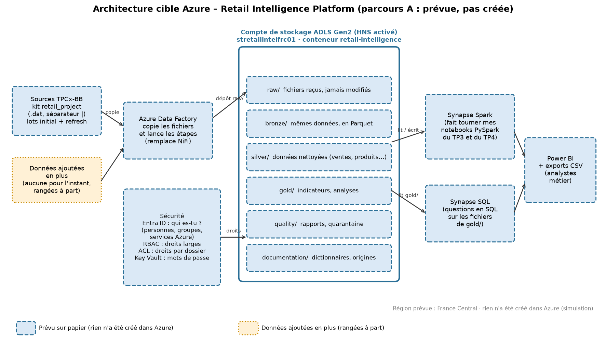
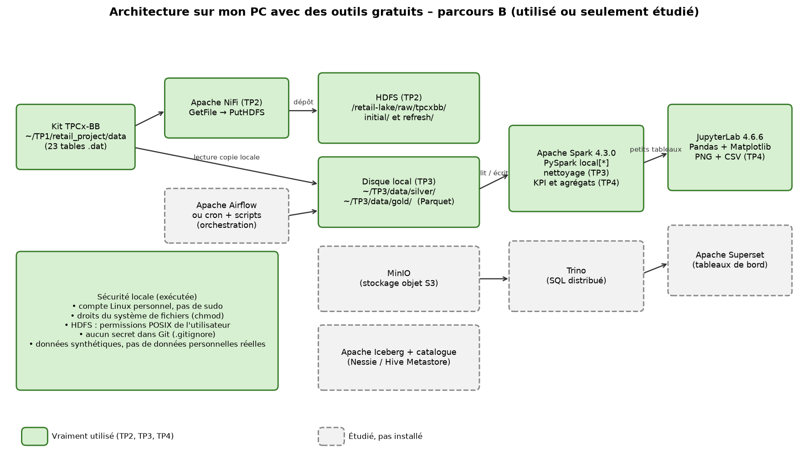

# Architecture Azure et version sans Azure (J4-07, UC-07 étapes 1, 6, 7, 8, 9)

## 0. Mon choix : **parcours B** (sur mon PC, avec des outils gratuits)

Je n'ai pas d'abonnement Azure. Azure CLI (l'outil pour piloter Azure depuis le terminal) n'est même pas installé sur mon PC Comme le prévoit le §9.2.2, j'ai donc choisi le **parcours B** :

- pour **Azure**, j'ai fait les **plans** (schéma, rangement des dossiers, droits d'accès, commandes), mais **je n'ai rien créé dans Azure** ;
- la version **sur mon PC** est celle que j'ai **vraiment utilisée** aux TP2, TP3 et TP4.

| État | Outils |
|---|---|
| **Vraiment utilisé** | Fichiers TPCx-BB, HDFS et NiFi (TP2), Spark/PySpark 4.3.0 sur mon PC (TP3, TP4), fichiers Parquet dans `~/TP3/data/`, JupyterLab + Pandas + Matplotlib (TP4) |
| **Étudié, pas installé** | MinIO, Apache Iceberg, Nessie / Hive Metastore, Trino, Airflow, Superset |
| **Prévu pour Azure, pas créé** | Abonnement, groupe de ressources, compte de stockage ADLS Gen2, conteneur, Entra ID, RBAC, ACL, Key Vault, Data Factory, Synapse, Power BI |

Les commandes qui auraient servi à tout créer dans Azure sont dans `simulation-azure.md` (J4-10).

## 1. Les éléments d'Azure et leurs liens (étape 1)

| Élément | C'est quoi, en simple | Dans mon projet |
|---|---|---|
| **Abonnement** | Le contrat avec Microsoft : c'est là qu'arrive la **facture**. Ce n'est pas un serveur. | Celui de l'école, s'il existe |
| **Groupe de ressources** | Un « dossier » qui regroupe tout ce qui concerne un projet. On peut tout supprimer d'un coup. | `rg-retail-intelligence-dev` |
| **Compte de stockage** | L'espace de stockage loué à Microsoft. | `stretailintelfrc01` |
| **ADLS Gen2** | Ce n'est pas un service à part : c'est un compte de stockage avec l'option **HNS** activée. Il remplace HDFS. | Il garde toutes mes données |
| **HNS** (espace de noms hiérarchique) | L'option qui donne de **vrais dossiers** (comme sur un PC) au lieu de simples noms de fichiers. Elle s'active à la création. | Voir `adls-organization.md` |
| **Conteneur** | Le premier niveau dans le compte, comme la racine `/retail-lake` de HDFS. | `retail-intelligence`, avec les dossiers raw, bronze, silver, gold dedans |
| **Microsoft Entra ID** | L'annuaire des utilisateurs : il vérifie **qui tu es** (personnes, groupes, et aussi les services Azure). | Groupes ingestion, data, analystes, admins |
| **RBAC** | Donne un **rôle** à quelqu'un sur une ressource entière (tout le compte, tout le conteneur). C'est large. | Qui peut gérer quoi |
| **ACL** | Donne des droits **lire / écrire / ouvrir** sur **un dossier ou un fichier précis**. C'est fin. N'existe que grâce au HNS. | Les analystes lisent `gold/`, mais pas `raw/` |

**Comment ça s'emboîte** : abonnement → groupe de ressources → compte de stockage (avec HNS = ADLS Gen2) → conteneur → dossiers → fichiers. Entra ID vérifie qui tu es. Ensuite le RBAC (au niveau du compte ou du conteneur), puis les ACL (au niveau des dossiers), disent ce que tu as le droit de faire.

## 2. À quoi servent Data Factory et Synapse (étape 6)

| Service | Son travail, en simple | Ce qu'il ferait dans mon projet | Ce que j'ai utilisé à la place |
|---|---|---|---|
| **ADLS Gen2** | **Ranger** les données | Garder les zones raw → gold | HDFS (TP2), disque de mon PC (TP3) |
| **Azure Data Factory (ADF)** | **Déplacer** les données et **lancer les étapes dans l'ordre**, à heure fixe. Il ne garde pas les données et ne fait pas les gros calculs. | Copier les fichiers `.dat` dans `raw/`, puis lancer les notebooks dans l'ordre (TP3 puis TP4) | NiFi (TP2) + je lance les notebooks à la main |
| **Azure Synapse Analytics** | Un **espace de travail** qui réunit plusieurs outils d'analyse | L'espace du projet | — |
| **Synapse Studio** | La page web de Synapse : notebooks, requêtes SQL, suivi | Remplace JupyterLab | JupyterLab |
| **Spark pools** | Des machines qui font tourner **Spark**, louées seulement quand on en a besoin (elles s'éteignent toutes seules) | Faire tourner mes notebooks PySpark en changeant juste les chemins des fichiers | Spark sur mon PC |
| **SQL serverless** | Poser des questions en **SQL** directement sur les fichiers, sans base de données. On paie selon la quantité de données lue. | Permettre aux analystes d'interroger `gold/`, et alimenter Power BI | — |

À retenir : **ADLS range, Data Factory déplace et organise, Spark calcule, Synapse réunit les outils.** Aucun ne remplace les autres. Le TP ne demande pas de créer Data Factory ou Synapse : je ne l'ai pas fait.

Remarque : aujourd'hui, Microsoft pousse plutôt un autre outil, **Microsoft Fabric**. Je parle de Synapse parce que c'est ce que demande le TP.

## 3. Schéma de l'architecture Azure (étape 7)

Fichier : `architecture_azure_cible.png`. On y voit :
- les données TPCx-BB et la place des données ajoutées en plus (aucune pour l'instant) ;
- Data Factory qui copie les fichiers ;
- ADLS Gen2 avec ses zones ;
- Spark qui calcule ;
- les résultats Gold, utilisés par SQL et Power BI ;
- la sécurité.

**Tout est en pointillés, car rien n'a été créé.**

## 4. La même chose sans Azure – parcours B (étape 8)

1. **Où sont rangées les données** : dans HDFS (`/retail-lake/`) pour les fichiers bruts (TP2), et sur le disque de mon PC (`~/TP3/data/`) pour Silver et Gold (TP3). MinIO n'est pas nécessaire : un simple dossier suffit pour le TP4.
2. **Les zones Bronze, Silver, Gold** : ce sont des **dossiers**.
   - `/retail-lake/raw/tpcxbb/initial/<table>/` : fichiers bruts, jamais modifiés ;
   - `~/TP3/data/silver/<table>/` : données nettoyées ;
   - `~/TP3/data/gold/<table>/` : données regroupées ;
   - `data/quarantine/` : lignes mises de côté.

   La zone Bronze est prévue mais vide : au TP3, je suis passée directement du brut au Silver.
3. **Iceberg et Parquet** :
   - **Parquet** est le *format des fichiers* (rangé par colonne, compressé). Je l'utilise vraiment.
   - **Iceberg** serait une *couche au-dessus* : un journal qui note chaque modification. Il permet d'annuler, de revenir à une ancienne version, et d'éviter les fichiers à moitié écrits.

   Je ne l'ai pas installé : mes dossiers Parquet n'ont donc pas ces protections.
4. **Les calculs** : Spark / PySpark 4.3.0 sur mon PC (12 cœurs, 2 Go de mémoire pour Spark). Nettoyage au TP3, indicateurs au TP4.
5. **Les requêtes** : faites avec Spark dans le notebook. **Spark SQL** (écrire du SQL dans Spark) est déjà disponible. **Trino** servirait à ce que plusieurs personnes posent des questions en SQL en même temps. Je l'ai seulement étudié.
6. **Le catalogue** (la liste des tables et de leur emplacement) : je n'en ai pas, les chemins sont écrits dans `config.py`. Avec Iceberg, il faudrait en ajouter un : **Nessie** ou **Hive Metastore**.
7. **Lancer les étapes dans l'ordre** : aujourd'hui je lance les notebooks à la main, dans l'ordre écrit dans le README. On pourrait utiliser un script lancé automatiquement chaque jour (**cron**), ou **Airflow**, qui enchaîne : dépôt → silver → gold → contrôles → analyses. Airflow ne calcule rien, il lance Spark.
8. **La sécurité sur mon PC** :
   - mon compte Linux personnel, sans droits administrateur ;
   - les droits sur les fichiers ;
   - HDFS avec les droits de mon utilisateur ;
   - aucun mot de passe dans Git ;
   - données inventées, donc pas de vraies données personnelles ;
   - un dossier par TP, et un dossier `data/test/` pour les essais.

**La preuve que ça marche** : le notebook `TP4_Retail_Intelligence.ipynb` a vraiment tourné sur mon PC.

## 5. Qui fait quoi : Azure et outils gratuits (étape 9)

| Rôle | Azure (prévu) | Ce que j'utilise | Pas installé | Ce qui manque par rapport à Azure |
|---|---|---|---|---|
| Ranger les données | ADLS Gen2 + HNS | HDFS (TP2) et disque de mon PC (TP3) | MinIO | Pas de copie de sécurité dans un autre lieu, pas de droits fins, place limitée |
| Format des tables | Parquet / Delta dans ADLS | Parquet | Iceberg | Pas d'historique, pas de retour en arrière |
| Calculer | Spark pool Synapse | Spark sur mon PC | — | Une seule machine, peu de mémoire |
| Requêtes SQL | SQL serverless | Spark (et Spark SQL) | Trino | Pas de SQL partagé entre plusieurs personnes |
| Liste des tables | Catalogue Synapse | Chemins dans `config.py` + docs | Nessie / Hive Metastore | Il faut connaître les chemins |
| Lancer les étapes | Data Factory | NiFi (TP2) + à la main | Airflow / cron | Rien n'est automatique |
| Graphiques | Power BI | Matplotlib dans JupyterLab | Superset | Graphiques fixes, pas de filtres |
| Qui a accès | Entra ID, RBAC, ACL | Compte Linux, droits sur les fichiers, droits HDFS | — | Un seul utilisateur |
| Mots de passe | Key Vault (coffre-fort) | Aucun mot de passe nécessaire | — | Pas de coffre-fort |
| Où ça tourne | Services gérés par Microsoft | Mon PC Ubuntu | Docker / machine virtuelle | Difficile à recréer à l'identique sur un autre PC |

**Pourquoi il faut plusieurs outils gratuits pour remplacer Synapse ?**

Synapse est un service **tout-en-un** : dans le même espace, on a Spark, le SQL, la liste des tables, les notebooks, l'automatisation et les droits. Microsoft s'occupe de tout.

Avec les outils gratuits, chaque fonction est un outil séparé :
- **Spark** pour calculer ;
- **Trino** ou **Spark SQL** pour le SQL ;
- **Iceberg** + un catalogue pour les tables ;
- **MinIO** ou **HDFS** pour ranger ;
- **Airflow** pour automatiser ;
- **Superset** pour les tableaux de bord.

Il faut tous les installer, les faire marcher ensemble et les entretenir soi-même. **Iceberg n'est pas « le Synapse gratuit »** : c'est seulement un format de table.

## 6. Coûts et précautions (si un jour on le fait vraiment dans Azure)

| Ressource | Ce qu'on paie | Précaution |
|---|---|---|
| Compte de stockage | La place utilisée chaque mois, et le nombre de lectures et d'écritures | L'option la moins chère (LRS) ; tout supprimer à la fin |
| Spark pool | Chaque minute où les machines sont allumées | Petite taille, **arrêt automatique** après 15 minutes |
| SQL serverless | La quantité de données lue à chaque question | Interroger les petits fichiers Parquet de `gold/`, pas les gros fichiers bruts |
| Data Factory | Chaque exécution et la durée des copies | Lancer à la main pendant les tests |
| Adresses IP, disques, machines | Payants même quand on ne s'en sert pas | Je n'en prévois aucun |

Règles :
- pas de carte bancaire et rien de payant ;
- un **budget avec alertes** ;
- tout dans un seul groupe de ressources, pour tout supprimer d'un coup ;
- ne jamais créer un deuxième compte pour avoir à nouveau l'offre gratuite.