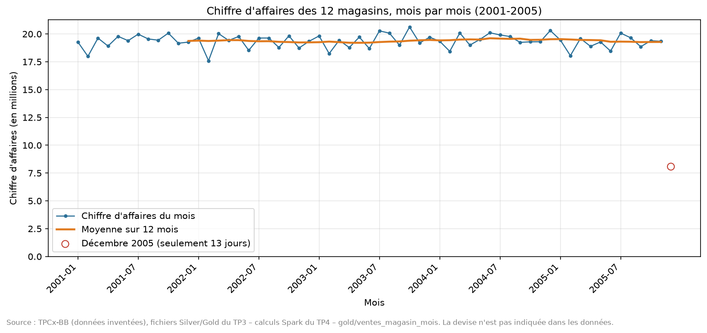
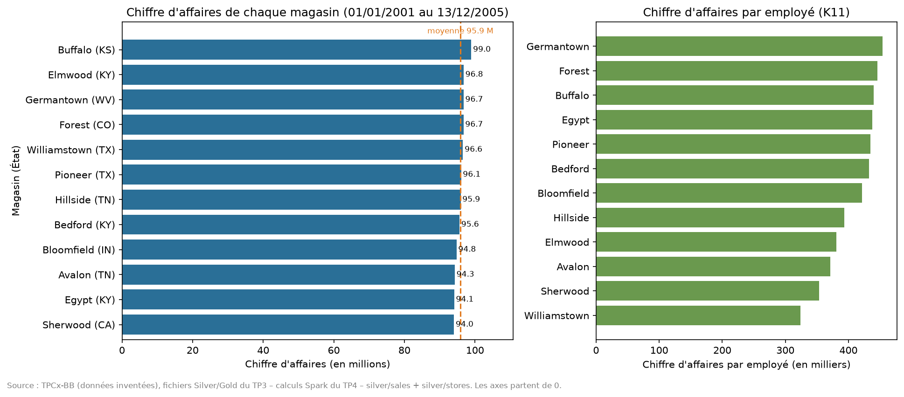
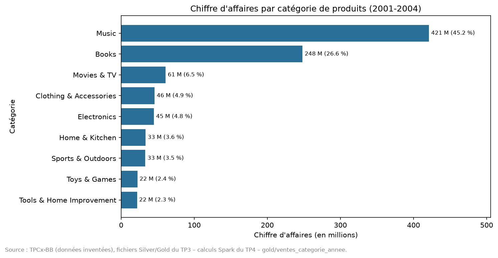
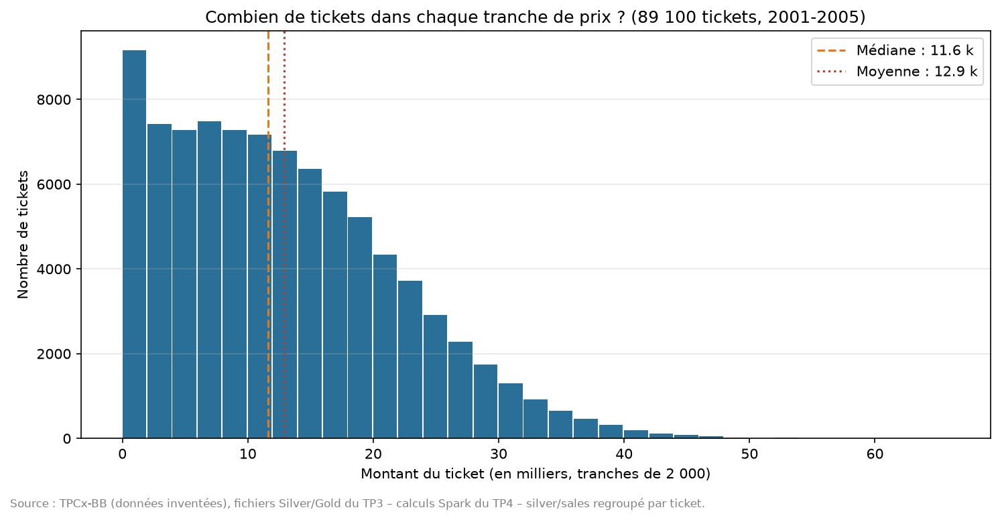

# Données, statistiques, analyses et graphiques (J4-01, J4-03, J4-04, J4-05)

Tous les calculs et tous les détails sont dans le notebook `TP4_Retail_Intelligence.ipynb`. Les tableaux sont dans `resultats/` et les graphiques dans `graphiques/`.

## 0. Les données utilisées (J4-01)

Toutes les données viennent du TP3 (fichiers TPCx-BB nettoyés, ventes du 01/01/2001 au 13/12/2005). Je les **lis seulement**, je ne les modifie pas.
- **Silver** = données nettoyées ; **Gold** = données déjà regroupées pour répondre à une question.
- **Parquet** = format de fichier fait pour l'analyse (rangé par colonne, compact, garde les types).

| Données | Zone | Lignes | Une ligne = | Pourquoi je l'utilise |
|---|---|---|---|---|
| `gold/ventes_magasin_mois` | Gold | 720 | 1 magasin pour 1 mois | Courbe des ventes mois par mois |
| `gold/ventes_categorie_annee` | Gold | 45 | 1 catégorie pour 1 année | Graphique par catégorie |
| `silver/sales` | Silver | 667 579 | 1 produit dans un ticket (pas un ticket entier) | Indicateurs, statistiques, magasins |
| `silver/stores` | Silver | 12 | 1 magasin | Nom et nombre d'employés |
| `silver/dates` | Silver | 109 573 | 1 jour | Année, mois et jour de chaque vente |

Tous en Parquet, dans `~/TP3/data/` (chemins dans `config.py`). Les contrôles qualité du TP3 sont bons (pas de doublon, pas de valeur vide utile, totaux Gold = Silver), et je les ai refaits dans le notebook (partie 2).

**Ce qui manque** :
- pas de Gold « par magasin » sur toute la période, donc je recompte les tickets dans le Silver ;
- pas de ventes web, retours, stocks ni avis (non nettoyés au TP3) ;
- décembre 2005 n'a que 13 jours (deuxième lot de données non traité).

## 1. Statistiques (J4-03)

Je regarde les chiffres **par ligne** (un produit dans un ticket) et **par ticket**. Rappel : la **médiane** est la valeur du milieu (la moitié est en dessous). Le tableau complet est dans `resultats/statistiques.csv`.

| Regardé par | Quoi | Nombre | Min | Max | Moyenne | Médiane | Total |
|---|---|---|---|---|---|---|---|
| ligne | quantité | 667 579 | 1 | 100 | 50,56 | 51 | 33 755 474 |
| ligne | montant payé | 667 579 | 0 | 18 745 | 1 723 | 878 | 1 150 529 586 |
| ticket | montant du ticket | 89 100 | 0 | 64 786 | 12 913 | 11 641 | 1 150 529 586 |
| ticket | produits par ticket | 89 100 | 1 | 14 | 7,5 | 7 | 667 579 |

Ce que je remarque :
- le total est le même par ligne et par ticket : bonne vérification ;
- la moyenne du montant d'une ligne est le double de la médiane : quelques lignes très chères tirent la moyenne vers le haut ;
- il y a presque le même nombre de tickets chaque année (environ 18 000) : c'est un effet des données inventées.

## 2. Analyse 1 – Comment évolue le chiffre d'affaires ? (question Q1)

| | |
|---|---|
| **Question** | Le chiffre d'affaires monte-t-il ou baisse-t-il, d'un mois à l'autre et d'une année à l'autre ? (Q1, posée par la direction) |
| **Données** | `gold/ventes_magasin_mois` (720 lignes) ; `silver/sales` + `silver/dates` pour K7 |
| **Méthode** | J'additionne les 12 magasins pour chaque mois, ce qui donne 60 mois. Je calcule une **moyenne mobile sur 12 mois** : pour chaque mois, la moyenne des 12 derniers mois, ce qui lisse la courbe. Je calcule K7 sur la même période chaque année. |
| **Résultats** | 19,36 millions par mois en moyenne. Le plus bas : 17,59 M (février 2002). Le plus haut : 20,63 M (octobre 2003). Les mois varient très peu (écart-type = 3,2 % de la moyenne). K7 : −0,75 % / +1,11 % / +0,18 % / −1,53 %. Février est toujours le mois le plus faible (18,06 M en moyenne). |
| **Ce que j'en comprends** | Les ventes n'augmentent pas et il n'y a pas de saison (pas de pic à Noël). Les petites différences viennent du nombre de jours dans le mois. |
| **Limites** | Données inventées ; décembre 2005 n'a que 13 jours (je l'affiche à part) ; ventes en magasin seulement ; retours non enlevés. |
| **Fichiers** | `ventes_par_mois.csv`, `ca_annuel.csv` |

## 3. Analyse 2 – Quels magasins marchent le mieux ? (question Q5)

| | |
|---|---|
| **Question** | Quels magasins vendent le plus (chiffre d'affaires, tickets, panier moyen, chiffre d'affaires par employé) ? (Q5, posée par les responsables de magasin) |
| **Données** | `silver/sales` + `silver/stores` |
| **Méthode** | Pour chaque magasin : chiffre d'affaires, nombre de tickets, quantité, panier moyen et chiffre d'affaires par employé. Puis l'écart de chaque magasin à la moyenne, et le classement. |
| **Résultats** | De 94,04 M (Sherwood) à 98,95 M (Buffalo). Moyenne : 95,88 M. Seulement 5,2 % d'écart entre le premier et le dernier. Le panier moyen va de 12 723 à 13 027. Par employé, on va de 324 089 (Williamstown, 298 employés) à 454 218 (Germantown, 213 employés). Williamstown est 5ᵉ en chiffre d'affaires mais dernier par employé. |
| **Ce que j'en comprends** | Le chiffre d'affaires seul ne permet pas de dire quel magasin est le meilleur. Le chiffre d'affaires par employé montre plus de différences, mais il dépend surtout du nombre d'employés. |
| **Limites** | Le nombre d'employés est supposé fixe pendant 5 ans ; les surfaces sont fausses ; on n'a pas les coûts ; un magasin qui vend plus n'est pas forcément mieux géré. |
| **Fichiers** | `ventes_par_magasin.csv`, `kpi_par_magasin.csv` |

## 4. Analyse 3 (bonus) – Quelles catégories vendent le plus ? (question Q3)

Données : `gold/ventes_categorie_annee`, seulement les années complètes (2001 à 2004).

Music fait 45,23 % du chiffre d'affaires et Books 26,65 %, soit 71,88 % à elles deux. Vient ensuite Movies & TV avec 6,53 %. Ces parts changent de moins de 0,4 point d'une année à l'autre.

Limites : on n'a pas de marge fiable, et ces parts viennent peut-être juste du nombre de produits dans chaque catégorie. Fichier : `ventes_par_categorie.csv`.

## 5. Bonus – Répartition des montants des tickets (histogramme)

Le graphique montre combien de tickets il y a dans chaque tranche de 2 000 (tranches calculées par Spark). La moitié des tickets est sous 11 641 (médiane), alors que la moyenne est de 12 913 : quelques très gros tickets tirent la moyenne vers le haut. Fichier : `distribution_montant_tickets.csv`.

**Règles suivies pour tous les graphiques** : titre clair, axes avec unité, axes qui partent de 0, source écrite en bas, peu de couleurs, et un commentaire sous chaque graphique dans le notebook.
